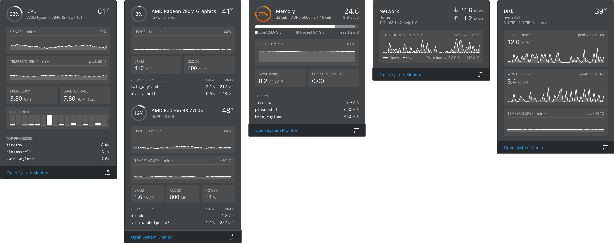
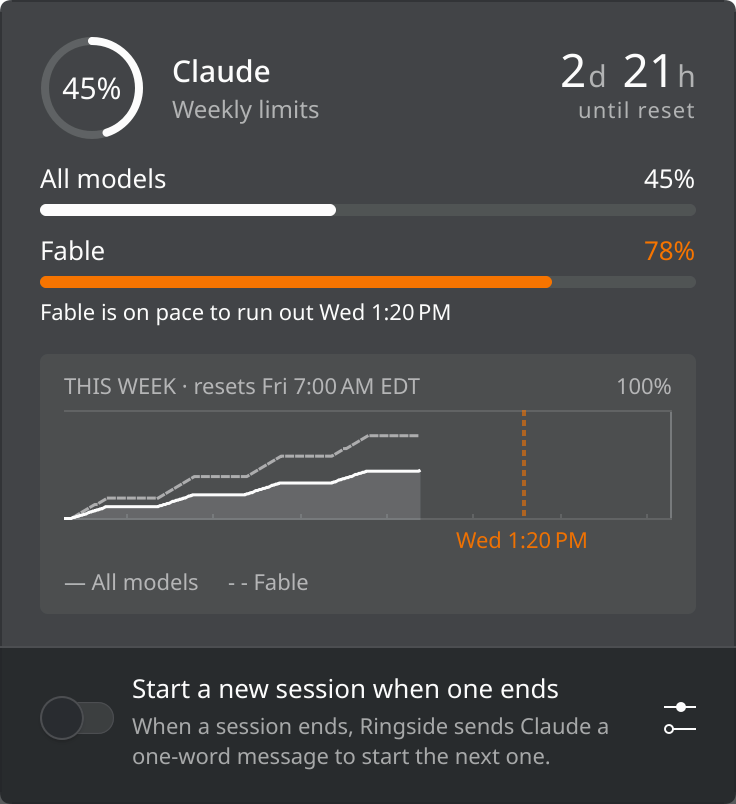

<p align="center">
  
</p>

<p align="center">
  <a href="https://github.com/emilyhamedian/ringside/actions/workflows/test.yml"></a>
  <a href="https://github.com/emilyhamedian/ringside/releases/latest"></a>
  <a href="LICENSE"></a>
</p>

Ringside puts your system in your KDE Plasma 6 panel as a row of rings: CPU,
GPU, memory, network and disk. If you use Claude or Codex, it can show your
usage limits too.


- See your CPU, GPU and memory at a glance, with their temperatures right
  beside them.
- Keep an eye on network and disk activity.
- Track your Claude and Codex limits: how much of the week you've used, when
  it resets, and whether you're on pace to run out. These stay off until you
  turn them on.
- Click any item for a popup with graphs of the last minute, hour or day, top
  processes and more. Point at a graph to compare what the graphs in that
  popup read at the same moment.
- It matches your Plasma theme and shows sizes in the units you chose in
  *Region & Language*. Rings turn amber, then red, when something runs hot
  or fills up.



## Install

Grab `ringside.plasmoid` from the
[latest release](https://github.com/emilyhamedian/ringside/releases/latest).
You can install it from *Add or Manage Widgets… → Get New… → Install Widget
From Local File…*, or from a terminal:

```bash
kpackagetool6 --type Plasma/Applet --install ringside.plasmoid
```

Then add **Ringside** to a panel like any other widget. To keep it at the
far end of the panel without a spacer, set *Panel space* in *Configure
Ringside… → Panel Items* to fill the free space.

To update to a new release, run the same command with `--upgrade` instead of
`--install`, then restart Plasma by logging out and back in, or with
`systemctl --user restart plasma-plasmashell`. To uninstall, remove it from
your panel and run:

```bash
kpackagetool6 --type Plasma/Applet --remove dev.emily.ringside
```

Building from source? Clone the repository and run `scripts/install.sh`.

### Requirements

Ringside supports KDE Plasma 6.8 and later, with ksystemstats and
libksysguard, normally installed with Plasma's System Monitor. Older
Plasma 6 releases may work, but aren't officially supported.

### Graph history

To keep the last hour and day across restarts, turn on *Keep the last hour
and day across restarts* under *General*. This needs Qt's LocalStorage
module, packaged as `qml6-module-qtquick-localstorage` on Debian and Ubuntu.

### Limitations

- Readings depend on what your hardware and drivers report. Missing
  readings show as a dash or are left out.
- Intel GPUs using i915 don't report temperature or VRAM. With xe, package
  temperature and dedicated VRAM depend on hardware and kernel support.
- Listing the processes using an NVIDIA GPU needs `nvidia-smi`. Only your
  own GPU processes are listed. Where the kernel doesn't count compute
  work's GPU usage (ROCm's, say), that shows as a dash.

## Claude and Codex



These need Python 3.11 or later. Turn them on in *Configure Ringside… →
Panel Items*.

- **Claude** needs [Claude Code](https://docs.claude.com/en/docs/claude-code)
  signed in with a subscription. Ringside uses its login to ask Anthropic for
  your limits, and renews it the same way Claude Code does, so you stay
  signed in.
- **Codex** needs the [Codex CLI](https://github.com/openai/codex) signed in,
  and Ringside asks it for your limits.

The ring shows how much of your weekly limit you've used and how long until
it resets. If your plan also has a per-model limit, that shows on an inner
ring. On first load, connection failures retry for up to 30 seconds while
the rings keep loading. When a check fails, the ring greys out, and if it
keeps failing, it's struck through; the popup tells you why. If a limit
resets before it was due, the popup says so and how much you got back, for a
day or until you've seen it. If Plasma can't find `claude` or `codex`, you
can tell it where they are under *AI Providers*.

**Remaining credits.** Turn on *Show remaining credits* for either provider
under *AI Providers* to show the balance below its popup's graph. Claude
checks only while its popup is open, at most once every 15 minutes. Codex
uses its existing usage check. Disabled credits and empty balances take up
no space. A failed check keeps the last balance marked as cached; hover over
it to see when it was read.

**Starting the next session.** A Claude five-hour session or Codex week only
begins when you next send a message. With the switch at the bottom of the
popup turned on, Ringside starts the next one for you as soon as the last one
ends, so the clock is already running by the time you're back. It does this by
sending a short message, which counts toward your limits like any other, so if
you pay for usage beyond your plan, you'll probably want to leave it off.

## Privacy

Ringside doesn't talk to anything outside your computer unless you turn on a
feature that needs to.

- Your system readings come from ksystemstats, the service behind Plasma's
  System Monitor, and from a small script,
  [`ringside-info.sh`](package/contents/code/ringside-info.sh), that reads
  `/proc`, `/sys` and udev as you.
- When you turn on Claude or Codex, Ringside runs
  [`usage.py`](package/contents/code/usage.py). It sends your Claude Code
  login only to Anthropic (`api.anthropic.com`, and `platform.claude.com` to
  renew it), asks the Codex CLI on your computer about Codex, and keeps the
  readings in `~/.cache/ringside/`.
- The public address, off until you turn it on under *General*, shows the
  address websites see in the network popup. To find it, Ringside asks
  [ipify.org](https://www.ipify.org), Mullvad's connection check (which can
  also tell you the city) or a service you choose, only while the popup is
  open and no more than once a minute. The answer is never saved.
- Graph history stays in memory unless you choose to keep it across
  restarts. It's then saved under
  `~/.local/share/plasmashell/QML/OfflineStorage/Databases/`, and turning the
  setting off deletes it again.

## When something looks wrong

Ringside notes what went wrong in Plasma's journal, without tokens, addresses
or account details. To see today's notes:

```bash
journalctl --user --since today QT_CATEGORY=ringside.usage QT_CATEGORY=ringside.network QT_CATEGORY=ringside.gpu QT_CATEGORY=ringside.setup
```

For more detail, including every check and how long it took, add the rule
`ringside.*.debug=true` in KDE's Debug Settings (`kdebugsettings`) and
restart Plasma.

## Contributing

Want to help? [CONTRIBUTING.md](CONTRIBUTING.md) covers the tests and the code
style.

## License

GPL-3.0-or-later. See [LICENSE](LICENSE).
