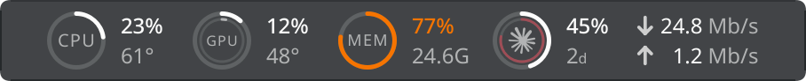
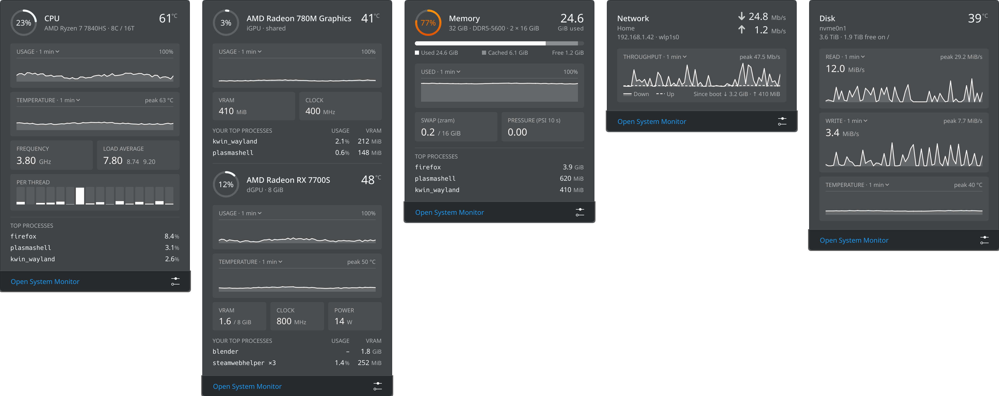
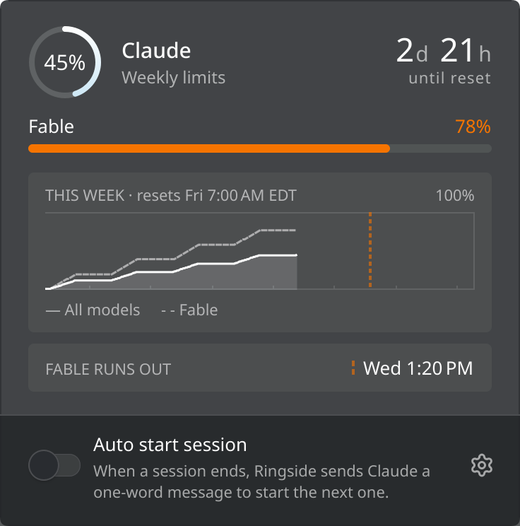

<p align="center">
  
</p>

<p align="center">
  <a href="https://github.com/emilyhamedian/ringside/actions/workflows/test.yml"></a>
  <a href="https://github.com/emilyhamedian/ringside/releases/latest"></a>
  <a href="LICENSE"></a>
</p>

A KDE Plasma 6 panel widget that shows CPU, GPU, memory, network, and disk
activity as rings, with optional usage limit tracking for Claude, Codex,
Kimi Code, OpenCode Go, and Antigravity.



- **System monitors:** CPU, GPU, and memory rings with temperatures, plus
  network and disk throughput. Click any item for graphs, top processes, and
  hardware details.
- **AI usage limits (opt-in):** Weekly or monthly quotas, per-model limits,
  run-out pace, remaining credits, banked resets, and optional session
  auto-start.
- **Native Plasma integration:** Follows your Plasma theme and data units,
  reads sensors from `ksystemstats`, and leaves sleeping discrete GPUs asleep.



## Install

Download `ringside.plasmoid` from the
[latest release](https://github.com/emilyhamedian/ringside/releases/latest)
and install it via *Add or Manage Widgets… → Get New… → Install Widget From
Local File…*, or from a terminal:

```bash
kpackagetool6 --type Plasma/Applet --install ringside.plasmoid
```

Then add **Ringside** to a panel.

- **Update:** rerun with `--upgrade`, then restart Plasma
  (`systemctl --user restart plasma-plasmashell`) or log out and back in.
- **Remove:** remove the widget from your panel, then run
  `kpackagetool6 --type Plasma/Applet --remove dev.emily.ringside`.
- **From source:** clone the repo and run `scripts/install.sh`.

### Requirements

- **KDE Plasma 6.8+** with `ksystemstats` and `libksysguard` (included with
  Plasma System Monitor).
- **Python 3.11+** *(optional)* — only needed if you enable AI usage items.
- **Qt LocalStorage** *(optional)* — only needed to keep graph history across
  restarts (`qml6-module-qtquick-localstorage` on Debian/Ubuntu).

## AI usage limits



All AI items are disabled by default. Enable them in
*Configure Ringside… → Panel Items* and configure providers under
*AI Providers*.

| Provider | Sign-in used for direct checks |
| --- | --- |
| **Claude** | [Claude Code](https://docs.claude.com/en/docs/claude-code) subscription login |
| **Codex** | [Codex CLI](https://github.com/openai/codex) login |
| **Kimi** | [Kimi Code](https://www.kimi.com/code) login or *Kimi For Coding* key in [OpenCode](https://opencode.ai) |
| **OpenCode Go** | [OpenCode](https://opencode.ai/docs/console/go/) Console login (`opencode auth login opencode`) |
| **Antigravity** | [Antigravity](https://antigravity.google) login (`agy`, desktop app, IDE, or OS keyring) |

- **CLIProxyAPI:** Claude, Codex, Kimi, and Antigravity can pool accounts
  through a local CLIProxyAPI v8 hub (`http://127.0.0.1:8317`, management key
  at `~/.config/cliproxyapi/management.key` with `0600` permissions), falling
  back to direct logins when unavailable.
- **Auto start:** Popups for Claude, Codex, OpenCode Go, and Antigravity
  include an opt-in switch to start the next rolling window automatically by
  sending a one-word message through the provider's CLI (counts toward quota;
  pauses while using a hub).
- **Custom CLI paths:** If Plasma's `PATH` doesn't include `claude`, `codex`,
  `opencode`, or `agy`, set their paths under *AI Providers*.

## Privacy

A fresh install makes no network requests. AI usage checks, CLIProxyAPI
queries, and the optional public IP lookup in the Network popup stay off until
you enable them. See [SECURITY.md](SECURITY.md) for the exact hosts contacted,
local files read, and caching behaviour.

## Troubleshooting

- **Missing hardware readings:** Ringside only shows what your kernel drivers
  expose (for example, Intel `i915` does not report temperature or VRAM, and
  NVIDIA process lists require `nvidia-smi`).
- **Logs:** Ringside writes warnings and errors to the user journal without
  tokens, addresses, or account details:

  ```bash
  journalctl --user --since today QT_CATEGORY=ringside.usage QT_CATEGORY=ringside.network QT_CATEGORY=ringside.gpu QT_CATEGORY=ringside.setup
  ```

  Enable `ringside.*.debug=true` in `kdebugsettings` (and restart Plasma) for
  per-check timing and debug logs.

## Contributing & License

See [CONTRIBUTING.md](CONTRIBUTING.md) for development setup, tests, and code
style. Licensed under [GPL-3.0-or-later](LICENSE).
