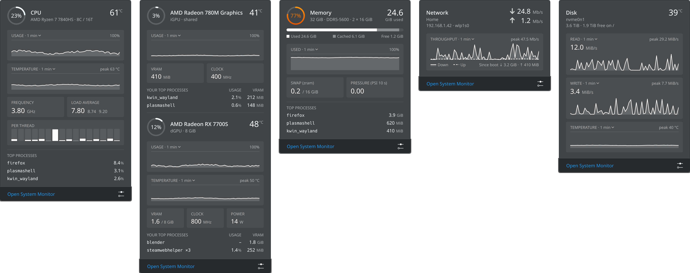
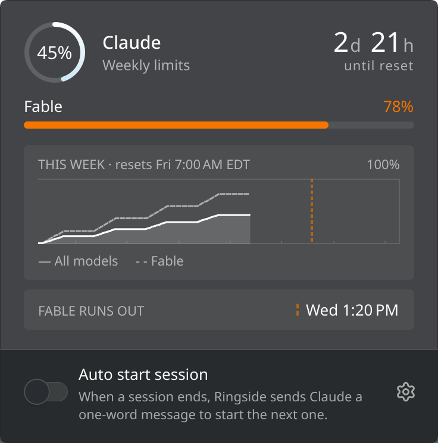

<p align="center">
  
</p>

<p align="center">
  <a href="https://github.com/emilyhamedian/ringside/actions/workflows/test.yml"></a>
  <a href="https://github.com/emilyhamedian/ringside/releases/latest"></a>
  <a href="LICENSE"></a>
</p>

Ringside shows your CPU, GPU, memory, network and disk as rings in your KDE
Plasma 6 panel. It can also show how much of your Claude, Codex, Kimi Code or
OpenCode Go usage limits you've used.


- CPU, GPU and memory at a glance, with their temperatures beside them.
- Network and disk activity.
- Your AI usage limits: how much you've used, when they reset, and whether
  you're on pace to run out. These are off until you turn them on.
- Click any item for graphs of the last minute, hour or day, the busiest
  processes and more.
- It follows your Plasma theme and units. Rings turn amber, then red, when
  something runs hot or fills up.



## Install

Download `ringside.plasmoid` from the
[latest release](https://github.com/emilyhamedian/ringside/releases/latest),
then install it from *Add or Manage Widgets… → Get New… → Install Widget From
Local File…*, or from a terminal:

```bash
kpackagetool6 --type Plasma/Applet --install ringside.plasmoid
```

Then add **Ringside** to a panel like any other widget.

- **Update:** run the same command with `--upgrade` instead of `--install`,
  then log out and back in, or run
  `systemctl --user restart plasma-plasmashell`.
- **Remove:** take it off your panel, then run
  `kpackagetool6 --type Plasma/Applet --remove dev.emily.ringside`.
- **From source:** clone this repository and run `scripts/install.sh`.

### What you need

- KDE Plasma 6.8 or later, with ksystemstats and libksysguard, which come
  with Plasma's System Monitor. Older Plasma 6 versions may work, but aren't
  supported.
- Python 3.11 or later, only for the AI usage items.
- Qt's LocalStorage module, only to keep graphs across restarts
  (`qml6-module-qtquick-localstorage` on Debian and Ubuntu).

### Known limits

- Ringside shows what your hardware and drivers report. Anything they don't
  report shows as a dash.
- Intel GPUs on the i915 driver don't report temperature or video memory. On
  xe, that depends on your hardware and kernel.
- Listing the processes using an NVIDIA GPU needs `nvidia-smi`, and shows only
  your own. GPU use the kernel doesn't count, such as ROCm compute work, shows
  as a dash.

## AI usage limits



Turn them on in *Configure Ringside… → Panel Items*. Each needs:

- **Claude:** [Claude Code](https://docs.claude.com/en/docs/claude-code),
  signed in with a subscription.
- **Codex:** the [Codex CLI](https://github.com/openai/codex), signed in.
- **Kimi:** a Kimi Code subscription, signed in to
  [Kimi Code](https://www.kimi.com/code) or connected as *Kimi For Coding* in
  [OpenCode](https://opencode.ai).
- **OpenCode Go:** an
  [OpenCode Go](https://opencode.ai/docs/console/go/) subscription, with
  OpenCode signed in to the OpenCode Console
  (`opencode auth login opencode`).

Each ring shows how much of your limit you've used and how long until it
resets: weekly for Claude and Codex, monthly for Kimi and OpenCode Go. If your
plan also has a per-model limit, it shows as an inner ring. Click the ring for
a graph and whether you're on pace to run out.

If a check fails, the ring greys out, and is crossed out if it keeps failing;
the popup says why. If a limit resets early, the popup tells you. Ringside
keeps Claude Code signed in, but never renews Kimi Code's or OpenCode's
sign-in. If one of those expires, open that app and Ringside picks it up
within five minutes. If Plasma can't find `claude` or `codex`, tell it where
they are under *AI Providers*.

**Credits.** For Claude and Codex, the popup shows your remaining credits
under the graph. When you've used up a limit and are spending credits, the
ring turns blue. *Show remaining credits* under *AI Providers* hides them.

**Auto start.** Ringside can start your next five-hour session on Claude,
Codex or OpenCode Go, or your next Codex week, as soon as the last one ends,
so the clock is already running when you're back. Turn it on with the switch
at the bottom of the popup. Each start sends a one-word message, which counts
toward your limits. Kimi's five-hour windows follow each other on a fixed
schedule, so there's nothing to start.

## Privacy

Ringside doesn't contact anything outside your computer unless you turn on a
feature that needs it:

- If you want your **Claude** limits, Ringside has to send your Claude Code
  login to Anthropic (`api.anthropic.com`, and `platform.claude.com` to keep
  it signed in).
- If you want your **Codex** limits, Ringside asks the Codex CLI on your
  computer, which checks with OpenAI using its own login.
- If you want your **Kimi** limits, Ringside has to send your Kimi Code
  sign-in or key to Kimi (`api.kimi.ai`, or `api.kimi.com` in China).
- If you want your **OpenCode Go** limits, Ringside has to send OpenCode's
  sign-in to OpenCode (`opencode.ai`).
- If you want your **public address** in the network popup, Ringside has to
  fetch it from [ipify.org](https://www.ipify.org), Mullvad (which can also
  tell you your city) or a service you choose. It asks only while the popup
  is open, at most once a minute, and never saves the answer. Turn it on
  under *General*.

Everything else stays on your computer. System readings come from Plasma's
System Monitor service and a small script,
[`ringside-info.sh`](package/contents/code/ringside-info.sh), that reads
`/proc`, `/sys` and udev. Usage readings are kept in `~/.cache/ringside/`.
Graphs are kept in memory, or in `~/.local/share/plasmashell/` if you turn on
*Keep the last hour and day across restarts* under *General*; turning it off
deletes them.

## If something looks wrong

Ringside logs problems to Plasma's journal, never with tokens, addresses or
account details. To see today's:

```bash
journalctl --user --since today QT_CATEGORY=ringside.usage QT_CATEGORY=ringside.network QT_CATEGORY=ringside.gpu QT_CATEGORY=ringside.setup
```

For every check and how long it took, add the rule `ringside.*.debug=true` in
KDE's Debug Settings (`kdebugsettings`) and restart Plasma.

## Contributing

Want to help? [CONTRIBUTING.md](CONTRIBUTING.md) covers the tests and the code
style.

## License

GPL-3.0-or-later. See [LICENSE](LICENSE).
